# CommandPulse CMMS - User Manual

Audience: plant operators, technicians, supervisors, planners, administrators, and auditors who use the CommandPulse CMMS web application.

This manual describes **what the software actually does today**. Where a task is not available in the screen you are looking at, this manual says so and tells you who to contact, rather than describing a button that does not exist. Tasks that currently require the API are marked **API only** and are not part of the point-and-click workflow.

Related documents:

- [Installation & Deployment Guide](INSTALLATION_GUIDE.md) - for the person installing or hosting the system
- [Administrator Guide](ADMIN_GUIDE.md) - for IT, database, and system administration
- [API Reference](API_REFERENCE.md) - every endpoint the backend exposes
- [README](../README.md) - overview and demo accounts

---

## Table of contents

1. [How to read this manual](#1-how-to-read-this-manual)
2. [Signing in and session behaviour](#2-signing-in-and-session-behaviour)
3. [How the application is laid out](#3-how-the-application-is-laid-out)
4. [Roles and what each one can actually do](#4-roles-and-what-each-one-can-actually-do)
5. [Requester](#5-requester)
6. [Technician](#6-technician)
7. [Maintenance Supervisor](#7-maintenance-supervisor)
8. [Maintenance Planner](#8-maintenance-planner)
9. [Administrator](#9-administrator)
10. [View-Only / Auditor](#10-view-only--auditor)
11. [Reference: the work order lifecycle](#11-reference-the-work-order-lifecycle)
12. [Reference: the seven reports](#12-reference-the-seven-reports)
13. [Reference: work order detail tabs](#13-reference-work-order-detail-tabs)
14. [Reference: operations that are not available in the screen](#14-reference-operations-that-are-not-available-in-the-screen)
15. [Troubleshooting](#15-troubleshooting)

---

## 1. How to read this manual

**Two conventions are used throughout:**

- `API only` - the operation has no screen in the web application. It is done through the API by an administrator, or requested from one.
- `[screenshot pending]` - no screenshot of this step exists yet. The written steps are complete and accurate without it.

**Screenshots** point at images in the `screenshots/` folder of this repository. They are captured from development builds and may differ slightly in wording from your deployment, but the layout, tabs, and buttons are the same.

**Where permissions are enforced.** The menus are almost the same for every signed-in user: the Administration item is hidden unless your role is Administrator, and the new-work-order screen requires Requester or above; every other page opens for any role. A small number of buttons are hidden based on your role, but most permissions are enforced by the server, not by the screen. If you perform an action your role is not allowed to perform, the server rejects it and you see an error rather than a successful change. This is the normal, expected behaviour, not a fault. It also means a screen that looks editable may still refuse your action.

---

## 2. Signing in and session behaviour

### 2.1 Sign in

1. Open the application URL supplied by your administrator, for example `http://localhost:3000` on a development machine.
2. Enter your username and password on the sign-in screen.
3. Select **Sign in**.

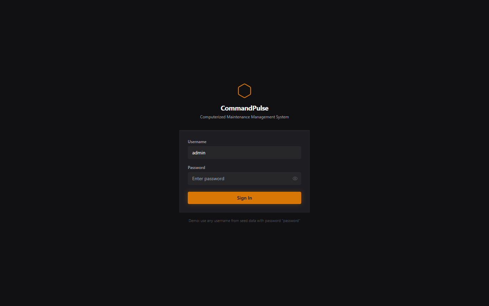

You are taken to the Dashboard. If you are already signed in and open the application again, you go straight to the Dashboard.

On a fresh demo installation the following accounts exist, all with the password `password`: `admin`, `planner`, `supervisor`, `tech1`, `tech2`, `operator`, and `auditor`. See [README](../README.md#demo-accounts). Change or remove these accounts before the system is used for anything real.

### 2.2 What happens when a sign-in is refused

| What you see | What it means | What to do |
|---|---|---|
| `Invalid credentials` | The username or password is wrong, **or** the account is disabled or deleted. | Check spelling and caps. If you are sure the password is right, ask an administrator to check whether the account is active. A disabled account is deliberately not reported separately, to avoid revealing which usernames exist. |
| `Account temporarily locked. Try again later.` | Five failed sign-ins within 15 minutes. The account is locked for 30 minutes. | Wait 30 minutes. The lock lifts by itself. If it must be lifted sooner, an administrator can clear it - see the [Administrator Guide](ADMIN_GUIDE.md#6-user-administration). |
| The page loads but shows no data, or an error after a click | Too many sign-in attempts from your network address. | Wait 15 minutes. The limit is 20 sign-in attempts per 15 minutes per IP address. |

Note that a correct password entered inside the lockout window still returns the lockout message. The 30-minute window is not shortened by getting the password right.

### 2.3 Idle timeout

If you do not move the mouse, click, type, scroll, or touch the screen for **30 minutes**, a warning appears for 60 seconds and then you are signed out and returned to the sign-in screen. Any of those actions counts as activity, so working normally will not trigger it.

The 30-minute limit is enforced by the system, not only by your browser: the sign-in token is short-lived (15 minutes) and the server refuses a session that has been idle, so bypassing the browser no longer keeps a session alive. Signing out also ends the session on the server. See [Security posture](ADMIN_GUIDE.md#12-security-posture).

---

## 3. How the application is laid out

### 3.1 Navigation

The left sidebar shows fourteen sections to every signed-in user (thirteen for anyone below Administrator - **Administration** is hidden):

| Section | What it is for |
|---|---|
| Dashboard | Plant-wide KPIs, system alerts, and work order status summary |
| Work Orders | List, create, and execute work orders |
| Preventive Maintenance | Time, meter, and combined PM plans with due dates |
| Notifications | Equipment problem reports, and conversion to a work order |
| Locations | Functional location register |
| Equipment | Equipment register and per-equipment detail, including meters and BOM |
| Work Centers | Work center register and craft capabilities |
| Crafts | Craft register used by labor booking |
| Task Lists | PM task list templates with operations |
| Materials | Material register |
| Code Lists | Failure and cause code registers |
| Safety Checklists | Safety checklist template register |
| Reports | The seven standard reports, each with Excel (.xlsx) export |
| Administration | Users and roles, audit log, and settings |

### 3.2 Command palette

Press `Ctrl+K` to open the command palette, then search for a screen or an action. `[screenshot pending]`

### 3.3 Standard list behaviour

Every register screen follows the same pattern: a search box, a row of filters, a count of matching records, and a table. Use the search box to filter as you type, and the filters to narrow by the columns offered on that screen. Records that have been deleted are hidden from all lists.

### 3.4 Bulk import and export

Every register screen has **Export** and **Import** controls beside the filters, with two exceptions that are export-only: **Notifications** and the **Users** register in Administration. Both controls work on the whole register, not on the filtered view: the file contains every non-deleted record, and a filter you have set on screen does not narrow it. On **Code Lists** each of the two tabs - Cause Codes and Failure Codes - has its own pair, so the two files are separate.

- **Export** downloads a comma-separated file (`.csv`) named after the module and today's date. The columns are the ones the import expects, foreign keys are written as the codes and usernames you see on screen, and dates are written `YYYY-MM-DD`, so the file can be edited in Excel and imported back. The users file carries no password or password hash.
- **Import** reads the same columns. Columns are matched by name rather than by position, so reordering them in Excel is safe, but the required ones must be present; the upload is refused with a message naming any that are missing.

What a bad row does depends on the module, because they were built for different jobs:

| Register | A rejected row | Why |
|---|---|---|
| Equipment, Materials, Work Centers, Crafts, Task Lists, Safety Checklists, Code Lists, PM Plans | Rejects the whole file | Master data is edited in bulk; a half-applied file is harder to reason about than a refused one |
| Work Orders, Functional Locations | Keeps the rows it accepted | A converted backlog is often messy; the response names each rejected line and the work already imported stays |

Three of the files carry headers only, because the shape they would need is a list, not a row:

- **PM Plans** creates a plan with a single asset (equipment code or functional-location code, exactly one of the two) and leaves an existing plan's assets, target list and meter thresholds alone; a meter-based plan must already have its meters, so the import creates **Time** plans only.
- **Task Lists** carries the list's code, description, class and asset; its operations and materials stay on the task-list screen.
- **Safety Checklists** is one row per item: the template name repeats on each row, and items are matched by their sequence number. Importing a template does not delete items that are absent from the file - remove those in the screen.

Importing crafts can re-cost work: a row that changes a craft's hourly rate re-prices every live work order that uses it, exactly as editing the rate on the Crafts screen does.

After an import the toolbar shows how many records were created and updated, and names the first rejected line with its reason. A refused file leaves the register exactly as it was. Import is restricted to **Maintenance Planner** and **Administrator**; every signed-in role can export, except the Users register, which is Administrator-only like the rest of Administration.

---

## 4. Roles and what each one can actually do

There are six roles. They form a hierarchy, where each role includes the permissions of the roles below it:

```
Administrator  (highest)
   |
Maintenance Planner
   |
Maintenance Supervisor
   |
Technician
   |
Requester
   |
View-Only  (lowest, read only)
```

A **Maintenance Supervisor** can therefore do everything a Technician can do, and a **Maintenance Planner** can do everything a Supervisor can do, in addition to planning.

The Administration screen contains an "RBAC Configuration" panel that lists these roles. Treat that panel as background information only: it is fixed text and it is not configurable. Its line that a Requester can "view own requests" is accurate - the Notifications list shows a Requester only the notifications they raised ([5.4](#54-follow-up-the-status-of-notifications)).

| Role | In practice |
|---|---|
| Requester | Raise work orders, report problems, track their progress, read the registers and reports |
| Technician | Execute work orders: operations, labor, materials, services, checklists, comments, attachments |
| Maintenance Supervisor | Everything a Technician does, plus approve and close work orders, **delete notifications**, run the reports |
| Maintenance Planner | Everything a Supervisor does, plus convert notifications into work orders and own the preventive maintenance plans |
| Administrator | Everything a Planner does, plus user administration and the audit log |
| View-Only | Read everything, change nothing |

---

## 5. Requester

### 5.1 Create a work order

You can raise a work order for maintenance, repair, or a request.

1. Select **Work Orders** in the sidebar.
2. Select **New Work Order** (or **+ New**, depending on your screen width).
3. Complete the form:
   - **Description** - what needs doing, in plain language.
   - **Type** - `CM` corrective, `PM` preventive, `PdM` predictive, `EM` emergency, or `CAL` calibration.
   - **Priority** - `High`, `Medium`, or `Low`.
   - **Equipment** and **Functional Location** - link the job to the asset.
   - **Reported By** is set to you automatically; there is no field to change it on this form.
   - **Description of the problem / details**, and the planned dates if you know them.
4. Select **Create**.

The work order is created in status **Draft** and appears in the list. Record the work order number shown in the list; you will use it for all follow-up.

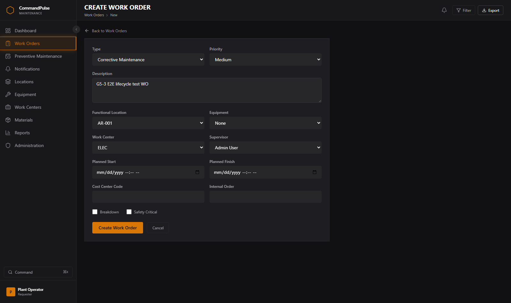

### 5.2 Track the progress of a work order

1. Select **Work Orders**.
2. Find your work order - search by work order number or description, or filter by status.
3. Select the row to open it.

The detail screen shows the current status, and the **History** tab shows every status change with its date and time.

**List scoping:** Technicians and Maintenance Supervisors see only work orders belonging to their own work center; Requesters see only the work orders they raised. A job outside those scopes will not appear in the list - ask a Planner or Administrator to reassign it if you need access.

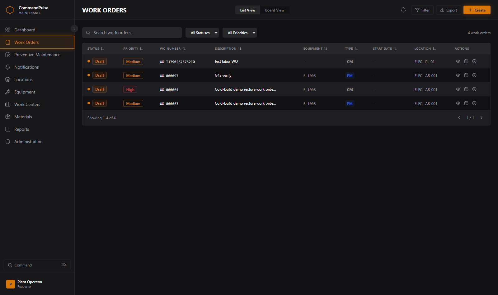

### 5.3 Raise a problem report (notification)

A **notification** records a problem against a piece of equipment or a location. It can later be converted into a work order.

**Raise a notification directly from the Notifications screen.** Select **Notifications**, then **New Notification**; choose a type and priority, a location or an equipment record, a description and any observations, and select **Save**. The command palette's **Create Notification** entry navigates to this list.

The same operation is available as `POST /api/notifications` for Requesters and above.

### 5.4 Follow up the status of notifications

1. Select **Notifications**.
2. Filter by **Status** to narrow to `Open`, `In Process`, `Completed`, or `Converted`, or use the search box.
3. Select a row to open it. The detail screen shows the reporter, the equipment or location, and the full history.

**Important:** the Notifications list is scoped to your role. A Requester sees only the notifications they raised; every other role sees the whole backlog. `[screenshot pending]`

### 5.5 Other things you can do

- Read the Dashboard for plant-wide status and any system alerts.
- Read the Equipment, Locations, Materials, and Work Centers registers.
- Open any of the seven reports and export them to Excel (.xlsx). Reports are available to every signed-in role, including Requester and View-Only.
- Add a comment to a work order and attach a document to a work order you raised.

---

## 6. Technician

### 6.1 Open a work order assigned to you

1. Select **Work Orders**.
2. Search or filter to find the job, then select it to open the detail screen. (Your list is scoped to your own work center.)

The detail screen has eleven tabs: **Operations, Materials, Labor, Services, Costs, Checklists, Notifications, Comments, Attachments, Failure, Cause & Notes, History**. See [section 13](#13-reference-work-order-detail-tabs).

### 6.2 Record the work

Work through the tabs as you carry out the job:

- **Operations** - each line of work to be performed. Record what was actually done.
  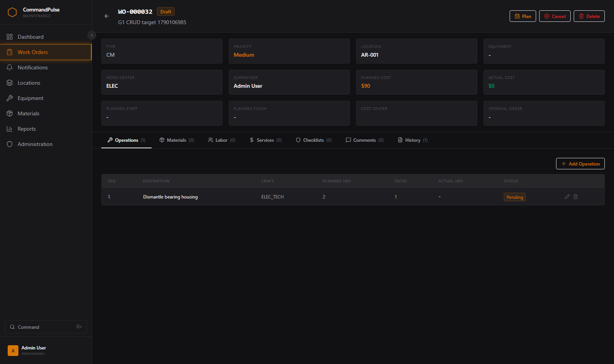
- **Materials** - parts and consumables issued to the job, drawn from the material register.
  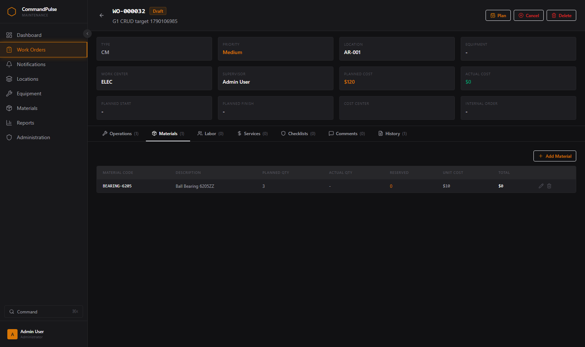
- **Labor** - time booked against the work, for yourself or a craft. This is what drives the labour cost shown on the work order.
  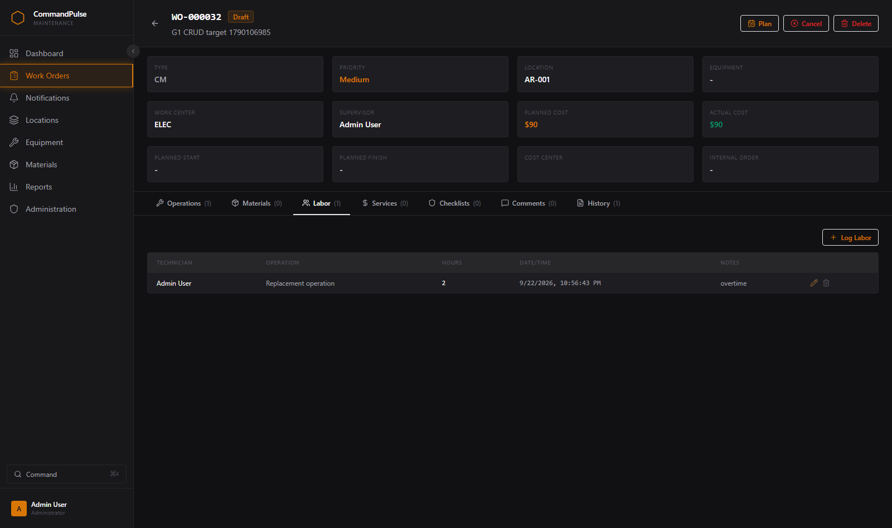
- **Services** - work sent to an external contractor, with the cost.
  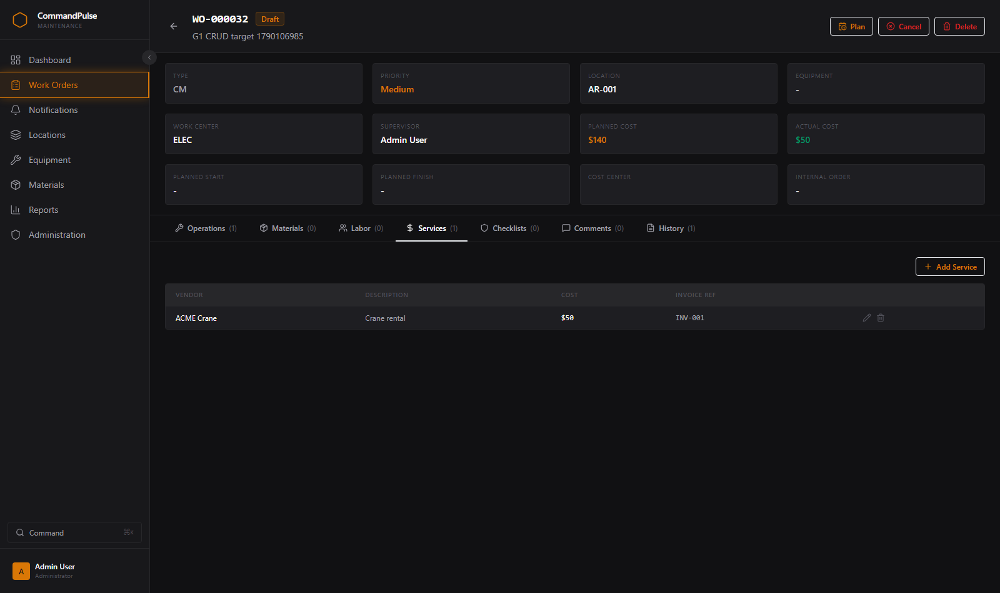
- **Checklists** - answer the safety and quality checklist items for this work order.
  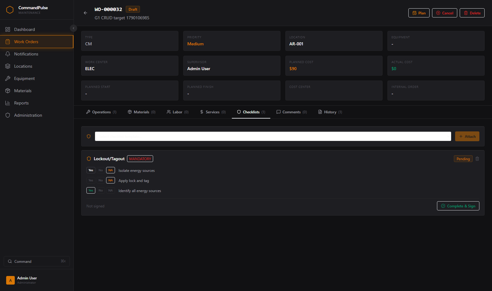
- **Comments** - free-text notes and discussion on the job.
  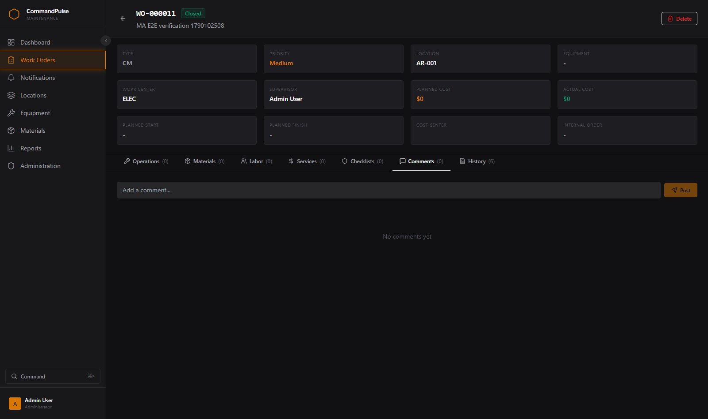

### 6.3 Attach a document to the work order

1. Open the work order.
2. Select the **Attachments** tab.
3. Select **Upload** and choose a file.
4. The upload completes and the file is listed with its name, size, and who uploaded it.

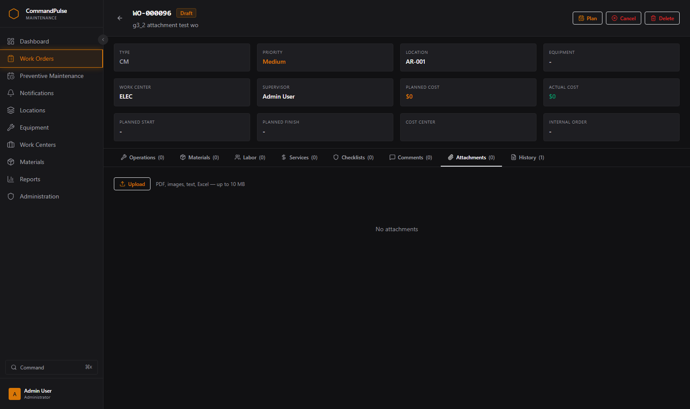

**Deleting an attachment** is limited to Maintenance Supervisor and Administrator. As a Technician you can upload and download but not delete. If you uploaded the wrong file, add a comment explaining, and ask a supervisor to remove it.

### 6.4 Complete the work order

When the job is finished:

1. Make sure the work order is **In Progress** (from **Scheduled**). Use the status control at the top of the work order.
2. Record the operations, labor, and materials as above - a work order closed with no labor recorded will show zero labour cost.
3. Select **Completed**.

Only a **Maintenance Supervisor** or **Administrator** can move a work order from **Completed** to **Closed**. Expect your supervisor to do that during review. If you select a status that is not a valid next step for the current status, the change is rejected and the current status is left untouched.

The full set of valid status changes is in [section 11](#11-reference-the-work-order-lifecycle).

---

## 7. Maintenance Supervisor

A Maintenance Supervisor can do everything in [section 6](#6-technician), plus the following.

### 7.1 Approve and schedule a work order

1. Open the work order from the list or the Dashboard.
2. Use the status control to move it through **Draft → Planned → Scheduled** as it is approved and scheduled.
3. Add a comment recording the approval decision if you need to explain it later.

### 7.2 Close a work order

1. Open the work order and confirm the job is genuinely finished: operations recorded, labor booked, materials issued, and any checklist answered.
2. Move it to **Completed**.
3. Select **Close**.

The **Close** button is available to Maintenance Supervisor and Administrator only. Once a work order is **Closed** no further status change is possible, and the record becomes effectively read-only.


You can also close from the work orders list: use the close control on the row, which is shown to Maintenance Supervisor and Administrator.

### 7.3 Convert a notification into a work order

This is how a reported problem becomes tracked work. Conversion requires the **Maintenance Planner** role or above.

1. Select **Notifications**.
2. Open the notification you want to action.
3. Review the description, equipment, and location, and add a comment if you need to add detail.
4. Select **Convert to Work Order**.
5. The system creates a linked work order and marks the notification **Converted**.

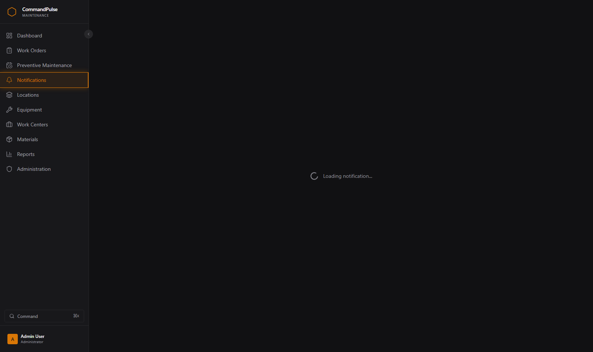
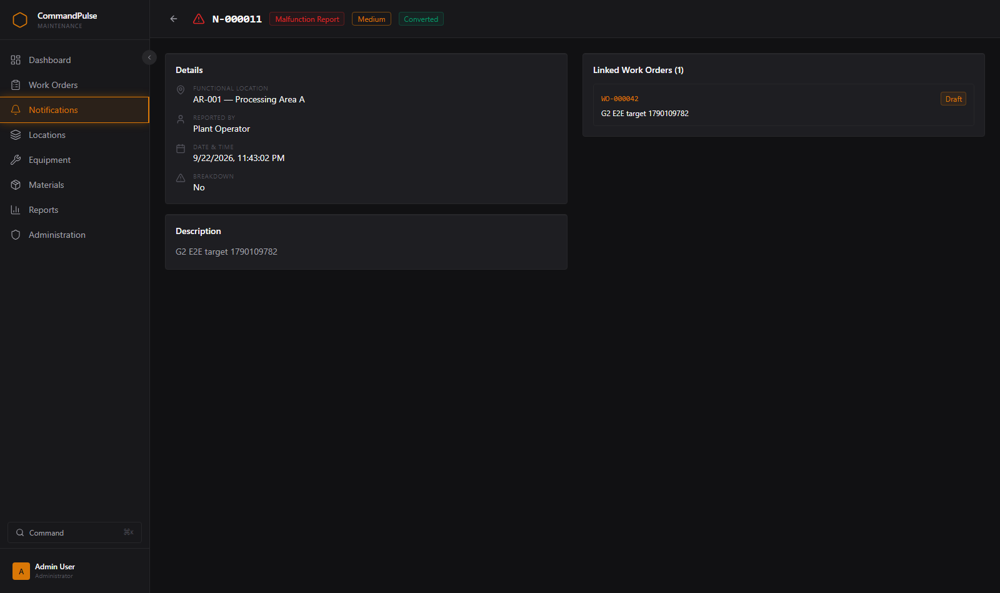

The new work order appears in the work orders list with a link back to the source notification, and the notification remains in the list as a permanent record of what was raised. The History tab on the work order shows the conversion.

### 7.4 Run the reports

1. Select **Reports**.
2. Choose one of the seven reports from the tabs.
3. Set the filter bar: a from/to date range, a functional location, an equipment item, a work centre, and an **include descendant locations** toggle. The filters apply to every report and to the export; **Clear filters** resets them.
4. Read the results, then select **Export** to download a server-built Excel (.xlsx) workbook for Excel or further analysis - the export carries the same filters.

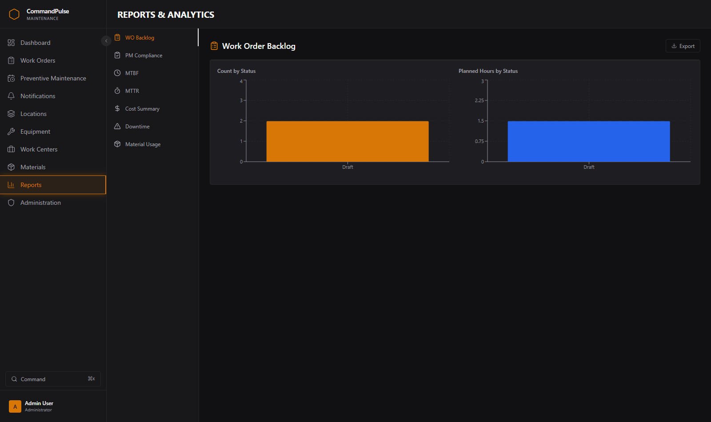
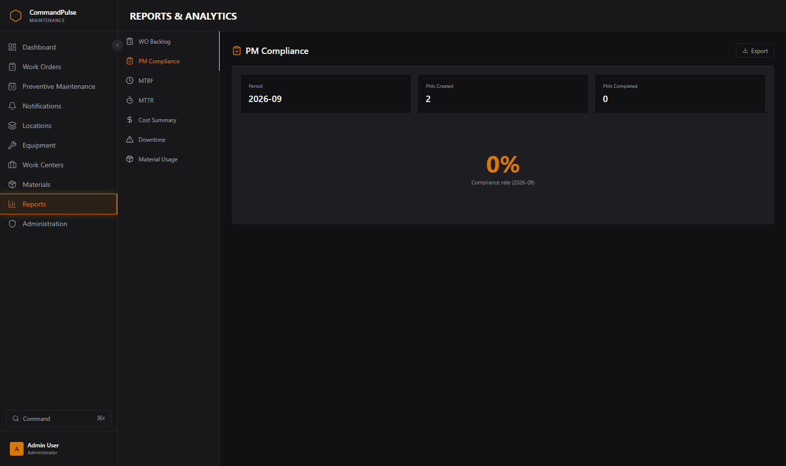
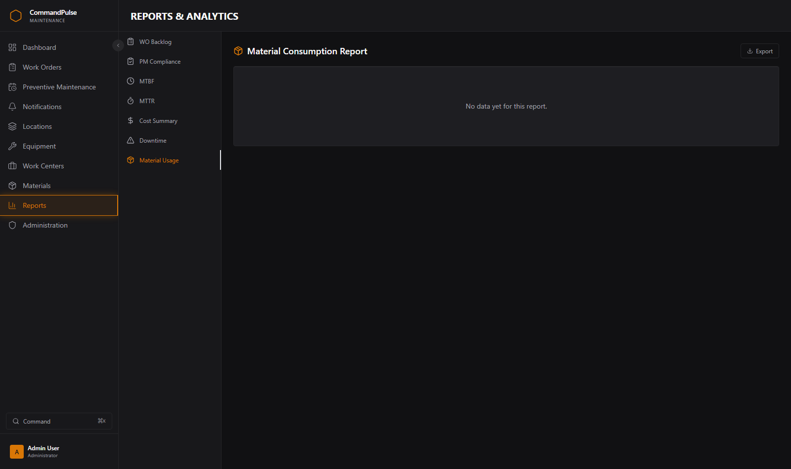

The seven reports are listed in [section 12](#12-reference-the-seven-reports). Reports are not restricted by role - every signed-in user can run and export them.

---

## 8. Maintenance Planner

A Maintenance Planner can do everything in [section 7](#7-maintenance-supervisor), plus preventive-maintenance plan and task-list maintenance.

### 8.1 View the preventive maintenance schedule

1. Select **Preventive Maintenance**.
2. The page shows summary tiles for Time-Based, Meter-Based, Combined, and Active plan counts.
3. The table below lists every plan with its plan code, description, equipment, strategy, interval, call horizon, work center, task list, status, next due date, and per-row **Generate**, **Edit** and (Maintenance Supervisor and above) **Delete** actions.

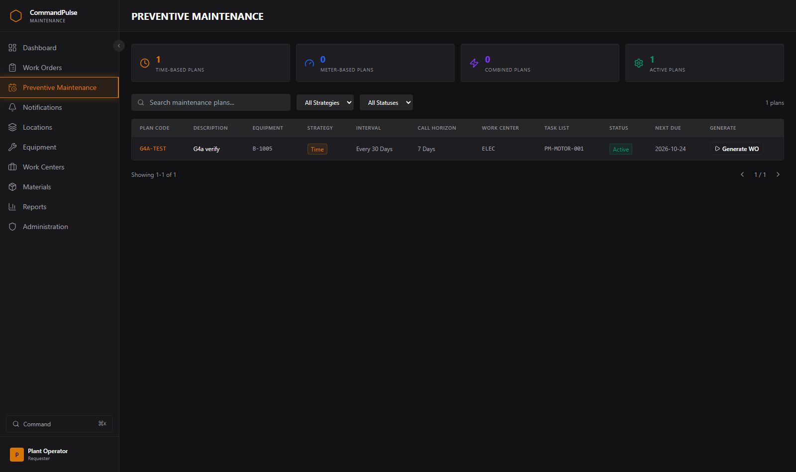


Use the search box and the strategy and status filters to find the plans you own. Note the **Next Due** column: that is the date the plan is next expected to generate a work order.

### 8.2 Generate a work order from a plan immediately

1. On the Preventive Maintenance page, find the plan.
2. Select **Generate** on that row.
3. A work order is created for the plan and the row shows the generation state while it runs.

Use this to test a plan or to bring forward work that the nightly run has not produced yet. The nightly automated run is described in the [Administrator Guide](ADMIN_GUIDE.md#5-scheduler-operations).

### 8.3 Create, edit or delete a PM plan

**In the UI:** on the **Preventive Maintenance** page, select **New Plan** to create one. Use the per-row **Edit** control to change a plan, and the per-row **Delete** control (Maintenance Supervisor and above) to remove one. Creating and editing require the Requester role or above.

The same operations are available as API calls:

- `POST /api/maintenance-plans` - create a plan (Requester and above)
- `PUT /api/maintenance-plans/{id}` - change a plan (Requester and above)
- `DELETE /api/maintenance-plans/{id}` - delete a plan (Maintenance Supervisor and above)

Provide the plan code, description, equipment, strategy, interval, call horizon, and work center. See the [API Reference](API_REFERENCE.md#maintenance-plans).

### 8.4 Edit a PM task list

**There is a Task Lists screen** (`/task-lists`, in the sidebar). Use it to create, edit, and delete task lists and their operations. The route behind it is `/api/task-lists`.

### 8.5 Run the scheduler manually

**In the UI:** the **Preventive Maintenance** page carries a **Run Scheduler** button, visible to Administrators, next to **New Plan**. It runs the job immediately and reports what it generated.

The same run is available as `POST /api/maintenance-plans/run-scheduler`, which requires an Administrator token. See the [Administrator Guide](ADMIN_GUIDE.md#52-running-the-scheduler-manually) for the exact command and for what to check afterwards.

---

## 9. Administrator

A Maintenance Planner can do everything in [section 8](#8-maintenance-planner), plus user and audit administration. **Editing an existing user, and resetting your own password, are both available from the screen.**

### 9.1 Administration screen

Select **Administration**. The screen has three tabs:

- **Users & Roles** - a list of every user with username, full name, email, role, active flag, and last sign-in. It carries an **Add User** form, a per-row **Edit** control ([9.3a](#93a-edit-a-user)) and a per-row **Deactivate** control ([9.2](#92-create-a-user), [9.3](#93-disable-a-user)).- **Audit Log** - every recorded change, filterable by table, action, and free text, and paginated. Only Administrators can read it; any other role selecting this tab receives an error.
- **Settings** - shows configuration. Three rows load from `GET /api/system-config` and are editable by an Administrator (saved via `PUT /api/system-config`): the two number-prefix rows (`wo_number_prefix`, `notif_number_prefix`) and the audit retention window (`audit_retention_years`); the remaining rows are a read-only display of static values.

### 9.2 Create a user

1. Select **Administration**, then the **Users & Roles** tab.
2. Select **Add User**.
3. Enter a username, a password of at least 12 characters, the person's full name, an email address, and a role.
4. Select **Create User**.

The new account is active immediately and can sign in. Optionally assign a work center for a Technician. The same operation is available as `POST /api/users` for Administrators. A duplicate active username is refused with **409**, and the action is written to the audit log. See the [Administrator Guide](ADMIN_GUIDE.md#61-create-a-user) for the field rules.

### 9.3 Disable a user

1. Confirm the person should no longer sign in. Disabling takes effect at their next sign-in attempt; they are not signed out of an existing session.
2. In **Administration → Users & Roles**, select **Deactivate** on that row and confirm.
3. To re-enable, send `"isActive": true`:

```
PUT /api/users/{userId}
{ "isActive": false }
```

A disabled account is refused at sign-in with the generic `Invalid credentials` message - the system deliberately does not tell the user that the account is disabled. The UI cannot re-enable an account; use the `PUT` call above, or see [6.3](ADMIN_GUIDE.md#63-disable-and-re-enable-a-user).

### 9.3a Edit a user

1. Select **Administration**, then the **Users & Roles** tab.
2. Select **Edit** on the user's row.
3. Change the role, full name, email or work center, or toggle the account active, then save.

The same call is `PUT /api/users/{userId}` (Administrator). A duplicate active username is refused with **409** and the change is written to the audit log.

### 9.3b Change a password

**Self-service:** every signed-in user can change their **own** password from the **Change password** dialog in the sidebar. You supply your current password and the new one. This is the normal recovery path when you still know the current password.

**Administrator reset of another user:** an Administrator can reset any user's password from the same dialog without supplying the target's current password - see [9.4](#94-reset-a-password).

### 9.3c Delete or decommission a user

The **Deactivate** button in **Administration → Users & Roles** performs the soft delete, so this is the same operation as disabling from the user's point of view - it removes the account from every list, blocks sign-in, and preserves the historical record so the person's name stays on work orders, labour entries and audit entries. The underlying call, if you prefer the API:

```
DELETE /api/users/{userId}
```

Deactivating your own account is refused with **400**. If the username should remain reusable, prefer disabling over deleting. See [6.7](ADMIN_GUIDE.md#67-delete-or-decommission-a-user).

### 9.4 Reset a password

**In the UI:** an Administrator can reset another user's password from the **Change password** dialog (the same dialog the user uses for self-service), which calls the endpoint below without the target's current password.

The same operation as an API call:

```
PUT /api/users/{userId}/password
{ "newPassword": "<the new password>" }
```

This requires an Administrator token and **does not require the target user's current password**. The reset is written to the audit log. Communicate the new password to the user through a channel other than email, and require a change on first use where your policy demands it. Note that the system has no separate "must change password" flag, so treat the reset as final.

### 9.5 Review the audit log

1. Select **Administration**, then the **Audit Log** tab.
2. Filter by table name, action, or search text to isolate what you need.
3. Page through the results.

The audit log is append-only through the application: there is no API to edit or delete an audit entry. For what is and is not recorded, see the [Administrator Guide](ADMIN_GUIDE.md#8-audit-log).

---

## 10. View-Only / Auditor

A View-Only user is a reader.

- You see all thirteen navigation sections available to your role (fourteen for an Administrator) and can open every screen: Dashboard, all registers, all work orders and their detail tabs, notifications, the PM plan register, and all seven reports with Excel (.xlsx) export.
- **Every write is refused by the server.** Opening a form, selecting a tab, or seeing an upload or create control does not mean the action will succeed; the save will be rejected. This is expected, not a fault.
- Only Administrators can read the audit log, so the **Audit Log** tab will return an error for you.
- Do not use a View-Only account to test changes, even on a development system: nothing you attempt will take effect, which can waste troubleshooting time.

---

## 11. Reference: the work order lifecycle

A work order moves through a fixed set of statuses. Only the transitions below are accepted; anything else is rejected and the status is left unchanged.

| From | You may move it to |
|---|---|
| Draft | Planned, Cancelled |
| Planned | Scheduled, Draft |
| Scheduled | In Progress, Planned, Cancelled |
| In Progress | Completed, Suspended |
| Suspended | In Progress, Cancelled |
| Completed | Closed |
| Closed | *(nothing - Closed is final)* |
| Cancelled | Draft |

Notes that matter day to day:

- Starting and finishing work (**Scheduled → In Progress → Completed**) needs Technician or above.
- **Closing** (**Completed → Closed**) needs Maintenance Supervisor or Administrator. The Close button is hidden from lower roles.
- Moving a job back to **In Progress** from **Suspended** is how you resume work that was paused.
- **Closed is final.** There is no reopen transition, so confirm the job is truly finished before closing it.
- Moving to **In Progress** and **Completed** records actual start and finish timestamps, which is what the cost and duration figures are calculated from.
- Cancelling from Draft, Planned, Scheduled, or Suspended is allowed; cancelling an In Progress job is not - finish or suspend it first.
- A transition can still be **refused with HTTP 409** even when the table above allows it, if the job is missing data the target status requires: leaving Draft needs at least one operation; moving to In Progress needs every mandatory checklist completed and every item answered; a breakdown job cannot be Completed without a cause code; a calibration job cannot be Completed without a pass/fail result. The error message names what is missing - record it and try again.

---

## 12. Reference: the seven reports

All seven are on the **Reports** screen, all are available to every signed-in role, and all export to Excel (.xlsx).

| Report | What it answers |
|---|---|
| WO Backlog | What is outstanding, by status, priority, and age? |
| PM Compliance | Are preventive maintenance plans being generated and completed on time? |
| MTBF | Mean time between failures per equipment item |
| MTTR | Mean time to repair per equipment item |
| Cost Summary | Planned vs actual cost, per cost center |
| Downtime | How long has each asset been down, and what drove it? |
| Material Usage | Which materials are being consumed, and on which work orders? |


---

## 13. Reference: work order detail tabs

| Tab | What it holds | Typical role |
|---|---|---|
| Operations | The lines of work to be performed, and what was done | Technician |
| Materials | Parts and consumables issued, with quantity and cost | Technician |
| Labor | Time booked, by person and craft, with cost | Technician |
| Services | External contractor work, with cost | Technician |
| Costs | Cost splits across cost centers | Planner |
| Checklists | Safety and quality checklist responses | Technician |
| Notifications | Notifications linked to this work order | Read only |
| Comments | Free-text notes and discussion | Everyone can add; only the author or an Administrator can delete |
| Attachments | Uploaded files; delete limited to Supervisor and Administrator | Everyone uploads, Supervisor+ deletes |
| Failure, Cause & Notes | Breakdown flag, cause code, failure code, long notes | Technician |
| History | Every status change, with timestamp and user | Read only |

**Operations, Materials, Labor, Services, Checklists and Comments** each have their own add form, so you stay on the work order while you work; **Costs** is edited in place and **Notifications** is a read-only list. The **History** tab is the authoritative record of what changed and when - use it instead of asking colleagues when something happened.

---

## 14. Reference: operations that are not available in the screen

These operations exist in the system but have no screen. This section exists so you are not left looking for a button that is not there. Operations that **do** have screens - raising a notification ([5.3](#53-raise-a-problem-report-notification)), editing equipment, materials and work centres, recording meter readings, editing a notification, filtering the reports, creating, editing or deleting a PM plan ([8.3](#83-create-edit-or-delete-a-pm-plan)), running the scheduler manually ([8.5](#85-run-the-scheduler-manually)), and creating, editing, disabling and deactivating a user ([9.2](#92-create-a-user), [9.3a](#93a-edit-a-user), [9.3](#93-disable-a-user)) - are deliberately absent from this list.

| Operation | Screen available? | How it is done |
|---|---|---|
| Re-enable a disabled user | No (Edit toggles the active flag) | `PUT /api/users/{userId}` with `isActive: true` - Administrator; or **Edit** the row and set it active |
| Clear a lockout early | No | **No API exists.** Database update - see the [Administrator Guide](ADMIN_GUIDE.md#64-clear-an-account-lockout) |
| Edit a system setting (number prefixes, audit retention) | Yes (Administrator) | `PUT /api/system-config`; other settings come from environment variables - see the [Administrator Guide](ADMIN_GUIDE.md#3-configuration) |
| Delete equipment or a material | No (deliberate) | Retire by status / deactivate instead; see [15](#15-troubleshooting) |

*Updated 2026-10-20 (v1.6.0): the "Reset a user's password" and "Edit a user's role, work center, name or email" rows were removed because both now have screens (the Change password dialog and the per-row Edit control); the re-enable row stays because the Edit control is the supported path but the API remains the direct one. Superseded wording, kept: the 2026-10-19 (C6) revision, which added the "Edit a user's role..." row because editing a user then had no UI control.*

If a task you need is on this list and there is no screen for it, raise it with your administrator. It is a known gap, not user error.

---

## 15. Troubleshooting

| Symptom | Likely cause | What to do |
|---|---|---|
| `Invalid credentials` and the password is definitely right | The account is disabled or deleted | Ask an administrator to check the account's active flag |
| `Account temporarily locked` | Five failed attempts in 15 minutes | Wait 30 minutes, or ask an administrator to clear it early |
| Error after clicking Save, on a form you can see | Your role is not permitted to perform that write | This is the server refusing the action. Ask a colleague with a higher role, or see [section 14](#14-reference-operations-that-are-not-available-in-the-screen) |
| A record you just created is not in the list | Search or filter is still applied | Clear the search box and filters |
| An attachment will not upload | File too large, or a duplicate name in use | Check the size limit, and rename the file |
| The Audit Log tab shows an error | Only Administrators can read the audit log | Expected for every other role |
| Signed out unexpectedly after a long pause | 30-minute idle timeout | Sign in again; unsaved form entries are lost |
| Reports show no rows | Date range or filters too narrow | Widen the date range and clear filters |
| A PM plan has not generated a work order | Not yet due, or the nightly run has not happened | Check **Next Due** on the plan, and ask an administrator to check the scheduler - see the [Administrator Guide](ADMIN_GUIDE.md#53-when-the-scheduler-reports-stale) |
| "Service temporarily unavailable" on a page | The backend is not running or is unreachable | Contact your administrator; this is a server-side problem, not yours |

When you report a problem, include the work order or notification number, the screen, what you selected, and the exact error text. The **History** tab on a work order often answers "what changed and when" without needing anyone to look it up.
